<a href="https://github.com/manyakaistha/PullStar/releases/latest"><picture><source media="(prefers-reduced-motion: reduce)" srcset="docs/images/readme/hero-still.svg" /></picture></a>

<p align="center">
  <a href="https://github.com/manyakaistha/PullStar/releases/latest"><strong>Download for macOS &amp; Linux ↗</strong></a> &nbsp;·&nbsp;
  <a href="#your-first-session">Quick start</a> &nbsp;·&nbsp;
  <a href="#mcp-integration">MCP setup</a> &nbsp;·&nbsp;
  <a href="#explore-the-documentation">Documentation</a>
</p>

<p align="center">
  <a href="https://github.com/manyakaistha/PullStar/actions/workflows/ci.yml"></a>
  <a href="https://github.com/manyakaistha/PullStar/releases/latest"></a>
  <a href="#get-pullstar"></a>
  <a href="#linux"></a>
</p>

<p align="center"><sub>A night-sky sequence captures hours of motion — and every small movement of the camera.<br />PullStar corrects the wobble and keeps the sky’s natural rotation, so your stars keep their trails.</sub></p>

### Steadier exposures. Smoother star trails. Your workflow.

Export the aligned exposures to your preferred editor, or create a trail image and trail-lapse video in PullStar. **Processing runs locally on your computer** — no account or cloud upload is required.

<p align="center">
  
  <br>
  <sub>The alignment studio. Preview your frames, choose your workflow, and follow processing in one workspace.</sub>
</p>

## How it works

<picture><source media="(prefers-reduced-motion: reduce)" srcset="docs/images/readme/pipeline-still.svg" /></picture>

**Correct the camera, not the sky.** PullStar matches the stellar field from frame to frame, solves for the camera’s movement, and removes it — while leaving the slow rotation of the sky intact. That rotation is what draws the trails.

<details>
<summary><strong>Inside the alignment</strong></summary>

Automatic alignment detects stars in each exposure and matches the field, including sequences with the celestial pole outside the image. Manual reference tracking is available when you need it. See [automatic alignment](docs/automatic-star-alignment.md) for the matching, motion correction, and algorithm validation.

</details>

## Choose your finish

<table>
<tr>
<td width="33%" valign="top">

<picture><source media="(prefers-reduced-motion: reduce)" srcset="docs/images/readme/finish-frames-still.svg" /></picture>

**Steadier frames for another editor.** An aligned TIFF, PNG, or JPEG sequence with a common crop. Skip trail creation entirely.

</td>
<td width="33%" valign="top">

<picture><source media="(prefers-reduced-motion: reduce)" srcset="docs/images/readme/finish-trails-still.svg" /></picture>

**A finished star-trail image.** A TIFF, PNG, or JPEG stack, with optional gap filling and synthetic trail extension.

</td>
<td width="33%" valign="top">

<picture><source media="(prefers-reduced-motion: reduce)" srcset="docs/images/readme/finish-video-still.svg" /></picture>

**A trail-lapse video.** MP4 or MOV, with H.264, HEVC, lossless H.264, or ProRes options. ProRes uses MOV.

</td>
</tr>
</table>

<sub>TIFF and PNG retain 16-bit data when the processing path provides it. JPEG is 8-bit. RAW inputs are developed into pixels; exports are not camera RAW or DNG files. See the [export workflow](docs/export-workflow.md) for format and destination details.</sub>

## Made for the night sky

**Polaris is optional.** Automatic alignment matches the stellar field, including sequences with the celestial pole outside the image. Manual reference tracking is available when you need it.

**Keep natural sky motion.** Correct the camera’s wobble while retaining the rotation that creates trails.

**Work with your exposures.** View JPEG, PNG, TIFF, and supported camera RAW files, with zoom, reference selection, and a frame filmstrip.

**Shape the result.** Preserve the foreground, fill timestamp gaps, and optionally extend or taper synthetic trails. Synthetic frames model motion; they do not recover missing observed detail.

**Control the workload.** Choose image and video resolutions, use memory-bounded CPU processing or supported OpenCL acceleration, and cancel active work from the workspace.

**Automate the workflow.** Use the included MCP server to inspect a sequence, compare settings, render previews, and manage exports.

## Get PullStar

The current desktop release supports **Apple Silicon Macs running macOS 14 or later** and **x86-64 Linux**. Python, FFmpeg, and the processing libraries are bundled in every installer.

### macOS

1. Download the **[latest macOS DMG ↗](https://github.com/manyakaistha/PullStar/releases/latest)**.
2. Open it and drag **PullStar** into **Applications**.
3. Launch PullStar and choose your exposure folder.

> [!IMPORTANT]
> The current release is **ad-hoc signed and not Apple-notarized**. macOS may block its first launch. If you trust the downloaded release, use **System Settings → Privacy & Security → Open Anyway** after the first launch attempt.

### Linux

Download the package that suits your distribution from the **[latest release ↗](https://github.com/manyakaistha/PullStar/releases/latest)**:

| Package | Best for | Install |
| --- | --- | --- |
| `PullStar-<version>-linux-x86_64.AppImage` | Any distribution | `chmod +x PullStar-*.AppImage`, then run it |
| `PullStar-<version>-linux-amd64.deb` | Debian, Ubuntu, Linux Mint and derivatives | `sudo apt install ./PullStar-*-linux-amd64.deb` |
| `PullStar-<version>-linux-x86_64.rpm` | Fedora, RHEL-family and openSUSE | `sudo dnf install ./PullStar-*-linux-x86_64.rpm` |
| `PullStar-<version>-linux-x64.tar.gz` | Manual install | Extract it and launch the `PullStar` executable |

> [!NOTE]
> The Linux packages are new. They are built for **x86-64** on **Ubuntu 20.04** (glibc 2.31) so they can run on older distributions. Each package was install-tested in clean containers using only its declared dependencies (see the compatibility details below); it has not yet been tested on real desktops. The AppImage needs FUSE 2 on some distributions (`libfuse2`); if it will not start, run it with `--appimage-extract-and-run`. The `.rpm` is **unsigned**, so your package manager may ask you to skip the signature check (`--nogpgcheck` for `dnf`, `--allow-unsigned-rpm` for `zypper`). Please [open an issue](https://github.com/manyakaistha/PullStar/issues) if PullStar does not run on your distribution.

<details>
<summary><strong>Verify the download and check compatibility</strong></summary>

Download `SHA256SUMS.txt` from the same release and compare its DMG entry against:

```bash
shasum -a 256 PullStar-1.0.2-macOS-arm64.dmg
```

On Linux, download the package and `SHA256SUMS.txt` into the same folder, then run:

```bash
sha256sum --ignore-missing -c SHA256SUMS.txt
```

The packaged macOS app has been tested on macOS 27.0.1. The Linux packages are x86-64 only. They were built on Ubuntu 20.04 and checked with the backend smoke test (image and video export). They were then installed in clean containers with only their declared dependencies, and the backend and a headless app launch (virtual display) were checked:

- `.deb`: Ubuntu 20.04, 22.04 and 24.04; Debian 11, 12 and 13 (Debian 11 needs its archive repositories now that it is end-of-life).
- `.rpm`: Fedora 45 and 46, AlmaLinux 8 and 9, Rocky Linux 9, openSUSE Leap and Tumbleweed. On Rocky/RHEL, remove it with `dnf remove --setopt=clean_requirements_on_remove=0 PullStar` to avoid dnf trying to remove protected packages.
- AppImage and `.tar.gz`: Arch Linux, Fedora, AlmaLinux 9, Debian 12 and Ubuntu 20.04.

These tests do not cover interactive use on a real desktop, Wayland/X11 specifics, or GPU/OpenCL acceleration. Intel Macs, Windows, and ARM Linux require a source installation; separate installers have not been validated.

Camera RAW support depends on the encoding supported by LibRaw/rawpy. An embedded DNG preview can display even when the underlying RAW pixels cannot be decoded for alignment or export. See [DNG support](docs/dng-viewing.md).

</details>

## Your first session

1. **Load your sequence.** Select **Load frames** and choose the folder containing your exposures.
2. **Choose alignment.** Use automatic star-field matching, or select manual reference stars in the viewfinder.
3. **Choose your output.** Select **Aligned images only** to continue in another editor, or choose star trails with optional frame and video export. Set your format and destination.
4. **Process and review.** Start the job, follow its progress, and review the output paths in **Results**. Active processing can be cancelled.

For RAW development, output bit depth, shared cropping, and export destinations, read the [image and video export guide](docs/export-workflow.md).

## MCP integration

<picture><source media="(prefers-reduced-motion: reduce)" srcset="docs/images/readme/mcp-still.svg" /></picture>

**Let an agent drive the darkroom.** PullStar includes **15 MCP tools** for sequence inspection, star analysis, settings recommendations, alignment comparisons, previews, quality evaluation, exports, and background jobs. The server ships in this repository’s `main` branch and inside the macOS and Linux apps.

Add this entry to your MCP client configuration after installing PullStar in **Applications**:

```json
{
  "mcpServers": {
    "pullstar": {
      "command": "/Applications/PullStar.app/Contents/Resources/backend/pullstar-backend",
      "args": ["--mcp"]
    }
  }
}
```

On Linux, point `command` at `resources/backend/pullstar-backend` inside the PullStar install directory. No separate Python installation is needed for the bundled server. For a source checkout, run:

```bash
uv --directory /absolute/path/to/PullStar run pullstar-mcp
```

See the [MCP guide](docs/mcp-server.md) for transports, tool arguments, and example workflows, or adapt [`mcp.json.example`](mcp.json.example). The legacy `star-aligner-mcp` command and `staraligner://` resource URIs remain available for client compatibility. Connect trusted clients; see the [security policy](SECURITY.md).

## Run from source

Use **Python 3.11**, [uv](https://docs.astral.sh/uv/), **Node.js 24 LTS** (or a supported Node.js 22.12+ installation), and npm. Install FFmpeg separately for source-based video export.

```bash
git clone https://github.com/manyakaistha/PullStar.git
cd PullStar
uv sync --locked
npm --prefix frontend ci
npm --prefix frontend start
```

For live frontend development, use `npm --prefix frontend run desktop`. For command-line processing:

```bash
uv run python main.py --input /path/to/exposures --auto --output /path/to/trails.tiff
```

The [CLI guide](docs/cli-guide.md) covers aligned-image export, video formats, and processing options. The [frontend guide](frontend/README.md) explains browser development and the desktop shell.

<details>
<summary><strong>Development checks and installer builds</strong></summary>

Run from the repository root, with FFmpeg available for video integration tests:

```bash
uv run pytest -q
npm --prefix frontend test
npm --prefix frontend run lint
npm --prefix frontend run build
```

To build the standalone macOS installer on Apple Silicon:

```bash
uv run python scripts/build_backend.py
npm --prefix frontend run package:mac
```

The DMG is written to `release/`. See [release engineering](docs/releases.md) for packaging, signing, and validation. The [1.0.0 validation report](docs/release-validation.md) records the application tests and installed-app checks performed for the release.

To rebuild the README artwork after a version bump: `uv run --with fonttools python scripts/readme_art/build.py`.

</details>

## Technology stack

**A desktop shell, a local engine, and an open door for automation.** The interface runs in Electron. A local Python service handles image processing and sends progress to the workspace over WebSockets. The MCP server exposes the processing engine to compatible automation clients.

<details>
<summary><strong>Inside the build</strong></summary>

| Layer | Technologies and purpose |
| :--- | :--- |
| **Desktop & interface** | **Electron · React · TypeScript** — desktop shell, native folder selection, and the alignment workspace. |
| **Styling & interaction** | **Tailwind CSS · Framer Motion · Lucide** — styling, motion, and interface icons. |
| **Local API** | **Python · FastAPI · Pydantic · Uvicorn · WebSockets** — validated job requests, background processing, and live progress. |
| **Astronomy** | **Photutils · Astroalign · Astropy** — star detection, field matching, and astronomical calculations. |
| **Images & scientific computing** | **NumPy · SciPy · OpenCV · scikit-image · Pillow** — transforms, filtering, blending, previews, and image export. |
| **RAW development** | **rawpy · LibRaw** — supported camera RAW decoding and embedded previews. |
| **Acceleration & video** | **PyOpenCL · FFmpeg** — optional GPU processing and video encoding, with CPU fallback for image processing. |
| **Automation** | **MCP Python SDK** — tools, resources, and prompts over stdio, SSE, and Streamable HTTP. |
| **Build & distribution** | **Vite · uv · npm · PyInstaller · Electron Builder** — frontend builds, dependency management, standalone Python bundling, and the macOS DMG and Linux AppImage, `.deb`, `.rpm`, and `.tar.gz` packages. |

Exact dependency versions are recorded in [`frontend/package-lock.json`](frontend/package-lock.json) and [`uv.lock`](uv.lock). Release assets include a dependency inventory and [third-party notices](THIRD_PARTY_NOTICES.md).

</details>

<sub>Electron · React · TypeScript · Tailwind CSS &nbsp;/&nbsp; Python · FastAPI · Astroalign · Photutils · OpenCV · rawpy · PyOpenCL · FFmpeg · MCP</sub>

## Explore the documentation

| Guide | What it covers |
| :--- | :--- |
| [Automatic alignment](docs/automatic-star-alignment.md) | Star-field matching, motion correction, and algorithm validation. |
| [Image & video exports](docs/export-workflow.md) | Images-only workflows, formats, bit depth, and destinations. |
| [RAW recovery](docs/noisy-raw-recovery.md) · [DNG viewing](docs/dng-viewing.md) | Dim exposures, RAW processing, and camera-preview limitations. |
| [Hardware & performance](docs/hardware-processing.md) | CPU workers, OpenCL support, and measured performance. |
| [MCP server](docs/mcp-server.md) · [CLI](docs/cli-guide.md) | Automation, settings, previews, and processing commands. |

**Found a problem?** [Open an issue](https://github.com/manyakaistha/PullStar/issues) with your PullStar version, operating system, input format, and steps to reproduce. For security concerns, follow [SECURITY.md](SECURITY.md). Read [CONTRIBUTING.md](CONTRIBUTING.md) before proposing a change.

## Ownership & licensing

The original PullStar code and artwork are **copyright © 2026 Manya Kaistha, all rights reserved**. This repository is public for inspection; no open-source license is granted. See [LICENSE](LICENSE).

Bundled dependencies retain their own licenses. [THIRD_PARTY_NOTICES.md](THIRD_PARTY_NOTICES.md) and [COPYING](COPYING) describe the applicable third-party terms. README artwork is set in Instrument Serif and JetBrains Mono (SIL Open Font License; see [`scripts/readme_art/fonts`](scripts/readme_art/fonts)).

<a href="https://github.com/manyakaistha/PullStar/releases/latest"><picture><source media="(prefers-reduced-motion: reduce)" srcset="docs/images/readme/footer-still.svg" /></picture></a>
