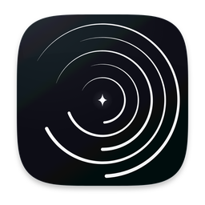
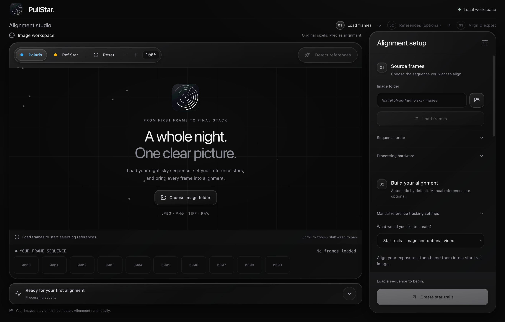

<p align="center"></p>
<h1 align="center">PullStar</h1>
<p align="center"><strong>Align the night. Keep the motion.</strong></p>
<p align="center">Correct camera wobble, export aligned frames, and create smooth star trails.</p>
<p align="center">
  
</p>
<p align="center">
  <a href="https://github.com/manyakaistha/PullStar/releases/latest">Download for macOS</a> ·
  <a href="docs/mcp-server.md">MCP server</a> ·
  <a href="docs/cli-guide.md">CLI guide</a> ·
  <a href="https://github.com/manyakaistha/PullStar/issues">Report an issue</a>
</p>



PullStar removes small camera movements from a night-sky sequence while preserving the sky’s natural rotation. Use it as an alignment stage in your existing workflow, or finish a trail image and video in the same workspace. All processing stays on your computer.

## What you can do

- **Align without Polaris.** Automatic star-field matching works when the celestial pole is outside the frame; manual reference tracking is also available.
- **Export frames and keep editing elsewhere.** Save a sequence with a common crop as TIFF, PNG, or JPEG, and skip trail creation entirely.
- **Create trails.** Stack aligned exposures, repair timestamp gaps, and optionally extend or taper synthetic trails.
- **Choose your delivery format.** Export TIFF/PNG/JPEG images and MP4/MOV video, including H.264, HEVC, lossless H.264, or ProRes where supported.
- **Work with RAW.** Supported camera formats use LibRaw through rawpy. DNG previews can open even when a particular RAW encoding cannot be developed; preview support does not guarantee export support.
- **Automate through MCP.** Inspect sequences, compare alignment settings, render previews, export images, and manage background jobs from an MCP client.

## Install on macOS

Download the **Apple Silicon DMG** from [Releases](https://github.com/manyakaistha/PullStar/releases), open it, and drag **PullStar** into **Applications**. Python, FFmpeg, and the processing libraries are included. The current binary targets **macOS 14 or later on Apple Silicon**; it has been tested on macOS 27.0.1. Intel Macs and other desktop platforms need a source installation.

**Signing status:** this release is ad-hoc signed and is not Apple-notarized. macOS may block its first launch. If you trust the downloaded release, use **System Settings → Privacy & Security → Open Anyway** after the first launch attempt. A notarized release requires an Apple Developer certificate and notarization credentials. Verify the SHA-256 checksum provided alongside the DMG.

## A first session

1. Choose **Load frames** and select a folder containing the exposure sequence.
2. Use automatic alignment, or select reference stars in the viewfinder.
3. Choose aligned images, trails, or both, then select the export format.
4. Start processing. Review the result and export paths in **Results**. Active work can be cancelled from the workspace.

Outputs are developed pixels, not camera RAW/DNG files. TIFF and PNG retain 16-bit data when the processing path provides it; JPEG is 8-bit. See the [export guide](docs/export-workflow.md) for details.

## Run from source

Requires Python 3.11, [uv](https://docs.astral.sh/uv/), Node.js 22.12+ (or Node.js 24 LTS), and npm. Install FFmpeg separately for source-based video export.

```bash
git clone https://github.com/manyakaistha/PullStar.git
cd PullStar
uv sync --locked
npm --prefix frontend ci
npm --prefix frontend start
```

For frontend development, run `npm --prefix frontend run desktop`. For the Python CLI:

```bash
uv run python main.py --input /path/to/exposures --auto --output /path/to/trails.tiff
```

## MCP integration

The MCP server ships in this repository’s `main` branch and in the macOS app. It supports stdio, SSE, and Streamable HTTP.

```json
{
  "mcpServers": {
    "pullstar": {
      "command": "/Applications/PullStar.app/Contents/Resources/backend/pullstar-backend",
      "args": ["--mcp"]
    }
  }
}
```

For a source checkout, use `uv --directory /absolute/path/to/PullStar run pullstar-mcp`. The legacy `star-aligner-mcp` command and `staraligner://` resource URIs remain available for client compatibility. See [MCP setup and tools](docs/mcp-server.md) and the ready-to-adapt [client configuration](mcp.json.example).

## Development and releases

```bash
uv run pytest -q
npm --prefix frontend test
npm --prefix frontend run lint
npm --prefix frontend run build
```

To build a standalone macOS installer on Apple Silicon:

```bash
uv run python scripts/build_backend.py
npm --prefix frontend run package:mac
```

The DMG is written to `release/`. See [release engineering](docs/releases.md), [contributing](CONTRIBUTING.md), and [security](SECURITY.md). Performance depends on frame resolution, memory, RAW decoding, and the available OpenCL drivers; CPU fallback is supported. No telemetry or cloud service is required.

## License

The original PullStar code and artwork are **copyright © 2026 Manya Kaistha, all rights reserved**; see [LICENSE](LICENSE). The repository is public for inspection. An open-source license has not been granted. Bundled components retain their own licenses; see [third-party notices](THIRD_PARTY_NOTICES.md) and [COPYING](COPYING).
