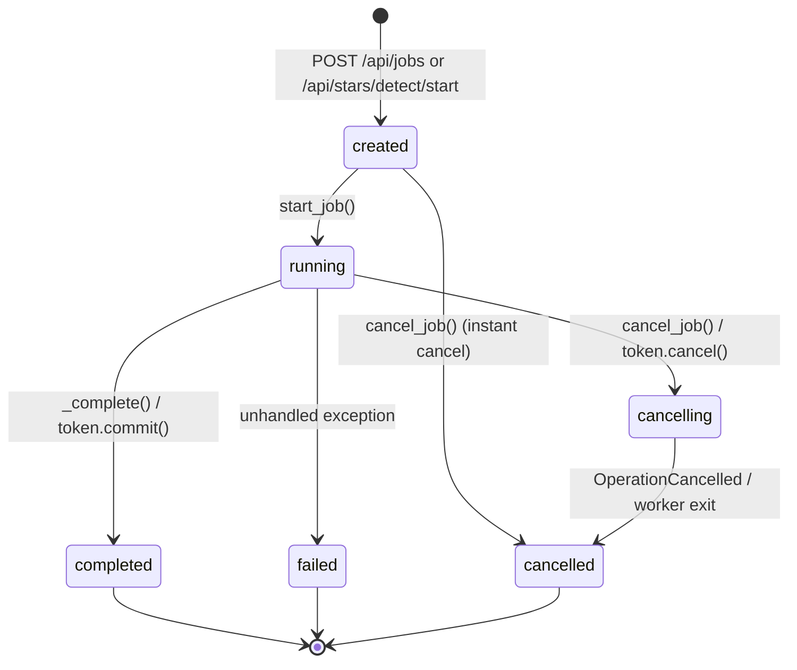

# Job Lifecycle, Cancellation, and Checkpoint Contract (P0-02)

This document freezes the job state machine, transition invariants, stage progress weights, cancellation arbitration, publication rules, and checkpoint/resume contracts across PullStar.

## 1. Job State Machine & Transitions

Defined in `backend/services/job_manager.py:10-140` and `rust/crates/pullstar-domain/src/job.rs:1-80`:

### 1.1 State Definitions
- `created`: Job record allocated and queued; no worker thread or process active.
- `running`: Worker thread actively computing; emits periodic progress events.
- `cancelling`: Cancellation requested. In-flight native operations are draining; cancel checks evaluate at loop boundaries.
- `completed`: Processing finished successfully; output files published to final destinations. **Terminal**.
- `failed`: Processing aborted due to an error before output publication. Staging directories deleted. **Terminal**.
- `cancelled`: Processing terminated early upon user request; temporary files cleaned up. **Terminal**.

### 1.2 Transition Rules and Invariants
- **Terminal Status Set** (`job_manager.py:10`):
  $$\text{TERMINAL\_STATUSES} = \{\text{"completed"}, \text{"failed"}, \text{"cancelled"}\}$$
  No transition out of a terminal state is permitted. Subsequent cancel or update requests on a terminal job are idempotent no-ops.
- **Race Condition Immunity** (`job_manager.py:48-50`, `job.rs:52-70`):
  - When `job["status"] == "cancelling"`, any subsequent event with `status == "running"` is dropped.
  - A transition from `cancelling` to `completed` is strictly forbidden. If a cancellation request arrives while final publication is pending, the two-phase commit token arbitrates the outcome: either publication completes atomically or the staging files are discarded and `cancelled` is emitted.

---

## 2. Event Fields and Telemetry Schema

Emitted over WebSocket (`/api/jobs/{id}/ws`) and returned by `GET /api/jobs/{id}` (`job_manager.py:38-75`):

| Field | Type | Presence | Description |
| :--- | :--- | :--- | :--- |
| `id` | `str` (UUIDv4) | Always | Unique job identifier. |
| `kind` | `str` | Always | Job type: `"alignment"` or `"detection"`. |
| `status` | `str` | Always | Current `JobState` (`created`, `running`, `cancelling`, `completed`, `failed`, `cancelled`). |
| `stage` | `str` | Always | Active stage: `"pending"`, `"preparation"`, `"conversion"`, `"pass1"`, `"crop_calc"`, `"pass2"`, `"video_render"`, `"done"`. |
| `progress` | `float` | Always | Progress fraction within the current stage ($0.0 \le x \le 1.0$). |
| `overall_progress` | `float` | Always | Monotonic total job progress fraction ($0.0 \le x \le 1.0$). |
| `activity` | `Optional[str]` | Optional | Stage activity detail (e.g. `"validating"`, `"processing_frame"`, `"ready"`). |
| `current` | `Optional[int]` | Optional | Index of current step / frame within active stage. |
| `total` | `Optional[int]` | Optional | Total steps / frames in active stage. |
| `fps` | `Optional[float]` | Optional | Live throughput (frames processed per second). |
| `drift_x` | `Optional[float]` | Optional | Measured horizontal star drift relative to reference frame (pixels). |
| `drift_y` | `Optional[float]` | Optional | Measured vertical star drift relative to reference frame (pixels). |
| `compute` | `Optional[dict]` | Optional | Hardware execution telemetry: `backend` (`"cpu"` / `"opencl"`), `device`, `workers`, `fallback_reason`. |
| `result_path` | `Optional[str]` | Terminal | Absolute path to primary output file or exported directory. |
| `error` | `Optional[str]` | Failed | Error message describing failure. |
| `preview_path` | `Optional[str]` | Completed | Path to previewable image (output stack or first exported frame). |
| `frames_dir` | `Optional[str]` | Completed | Destination path for aligned frame exports when `save_frames=True`. |
| `frame_count` | `Optional[int]` | Completed | Total count of exported aligned frames. |
| `video_path` | `Optional[str]` | Completed | Absolute path to generated `.mp4` or `.mov` trail-lapse video. |
| `conversion_format`| `Optional[str]` | Completed | Format used for pre-converted frames (`"none"`, `"jpg"`, `"tiff"`). |
| `converted_files_dir`| `Optional[str]`| Completed | Location where pre-converted frames were saved. |

---

## 3. Overall Progress Calculation and Stage Weights

Defined in `backend/services/job_manager.py:51-64`:

Overall progress is guaranteed to be monotonic:
$$\text{overall\_progress}_{t+1} = \max(\text{overall\_progress}_t, \text{start}_{\text{stage}} + (\text{end}_{\text{stage}} - \text{start}_{\text{stage}}) \times \text{progress}_{\text{stage}})$$

### Stage Progress Weight Ranges

| Stage | Default Range (`start`, `end`) | With Pre-Conversion (`start`, `end`) | Notes |
| :--- | :--- | :--- | :--- |
| `preparation` | `0.00` – `0.05` | `0.00` – `0.05` | File discovery, validation, worker sizing. |
| `conversion` | *(omitted)* | `0.05` – `0.20` | Batch raw/image pre-conversion before alignment. |
| `pass1` | `0.05` – `0.35` | `0.20` – `0.35` | Star detection, centroiding, transform calculation. |
| `crop_calc` | `0.35` – `0.40` | `0.35` – `0.40` | Common valid bounding box calculation. |
| `pass2` | `0.40` – `0.99` (`0.95` if video) | `0.40` – `0.95` | Warp resampling, blending, frame export. |
| `video_render` | `0.95` – `0.99` | `0.95` – `0.99` | Encodes video snapshots via FFmpeg / OpenCV. |
| `done` | `0.99` – `0.99` | `0.99` – `0.99` | Atomic publication and cleanup. |
| `completed` | `1.00` | `1.00` | Terminal completion. |

Covering Test: `tests/test_job_progress.py:12-45`.

---

## 4. Staged Publication and Atomic Commit Rules

Defined in `backend/engine/alignment_engine.py:533-585`:

1. **Isolation in Temporary Staging Directory**:
   - Renders are staged in a hidden temporary directory named `.staraligner-<uuid>` located inside `output_file.parent`.
   - Never write in-flight outputs directly into destination files or existing directories.
2. **Cancellation and Cleanup**:
   - If cancelled or failed, the staging directory is completely unlinked.
   - Any pre-existing completed outputs at the target location remain unmodified.
3. **Publication Commit**:
   - When processing completes, `cancellation_token.commit(publish)` arbitrates final publication:
     - Moves exported frames folder to `frames_target`.
     - Replaces target files using atomic filesystem rename (`path.replace`).
     - Removes intermediate `.field-checkpoint.npz` files upon success.
     - Emits `status: "completed"`.

Covering Tests: `tests/test_cancellation.py:16-65`, `tests/test_exports.py:54-66`.

---

## 5. Checkpoint and Recovery Contracts

### 5.1 Automatic Stellar Field Recovery (`.field-checkpoint.npz`)
Defined in `backend/engine/field_alignment.py:230-245` and `field_alignment.py:284-295`:
- File location: `<output_file>.field-checkpoint.npz`.
- Saved format: Uncompressed NumPy archive with `allow_pickle=False`.
- Signature Keys (`_checkpoint_signature`):
  - `version`: integer `1`.
  - `files`: list of tuples `[(resolved_path, size_bytes, mtime_ns), ...]`. Validates that input sequence has not changed.
  - `crop`: dict containing `x_start`, `x_end`, `y_start`, `y_end`, `width`, `height`.
  - `options`: list of 14 validated parameters `[extension_factor, ghost_frames_per_real, synthetic_fade_factor, use_foreground_mask, fill_gaps, blend_mode, save_frames, no_stack, raw_noise_reduction, raw_exposure_ev, video_slowdown, image_resolution, tail_taper_strength, tail_angle_threshold]`.
  - `transforms`: list of 6-element row-major affine transformation matrices rounded to 6 decimals.
  - `valid`: list of booleans indicating transform validity.
  - `accumulator`: float32 array holding running stacked pixels.
  - `step`: integer indicating last completed schedule step ($0 \le \text{step} \le \text{len(schedule)}$).
- **Resume Validation Invariants**:
  - If `signature` does not match, or `accumulator.shape` differs: aborts with `ValueError("Recovery checkpoint belongs to different inputs or settings. Disable resume to start again.")`.
  - **Video Resume Invariant**: `video_enabled=True` **disables** accumulator resume (`field_alignment.py:284-285`). An encoded video cannot resume mid-stream from a pixel accumulator alone without silently losing the beginning of the video. When video is requested, the full schedule is re-rendered.

### 5.2 Legacy Manual Tracking Checkpoint (Python Pickle)
Defined in `core/checkpoint.py:10-80`:
- Pattern: `checkpoint_pass{pass_num}_frame{frame_num:04d}_{timestamp}.pkl`.
- Uses Python `pickle.dump` with protocol `pickle.HIGHEST_PROTOCOL`.
- Contains: `alignment_data`, `last_frame`, `pass_num`, `timestamp`, `version` (`"2.0"`), and optional `additional` dict.
- **Migration Policy**:
  - Per migration constraints, **Python pickle is deprecated and read-only-by-old-app**.
  - The Rust rewrite will not deserialize or generate Python pickle files.
  - All modern checkpointing across automatic and manual tracking will use versioned binary/JSON interchange types conforming to `pullstar-domain` Schema Version 1.
